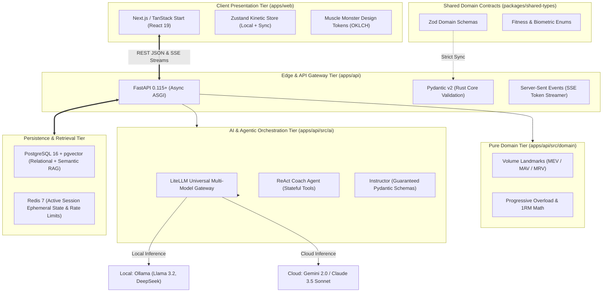

# VitalAI — Enterprise System Architecture Specification

> **Engineering Authority**: Senior Staff / Principal AI Systems Architect (Google / OpenAI / Anthropic Standards)  
> **Target Revision**: v2.0-Foundation  
> **Status**: Approved Base Architecture

---

## 1. Executive System Topology

VitalAI is an enterprise-grade, polyglot AI fitness and health coaching platform engineered for sub-50ms UI response latency, streaming AI token delivery, and rigorous mathematical periodization.



---

## 2. Polyglot Monorepo Engineering Standards

VitalAI operates as an industrial-grade polyglot monorepo orchestrating TypeScript (Frontend and Shared Type Contracts) and Python (Asynchronous AI Engine and Mathematical Periodization):

```
vitalai/
├── apps/
│   ├── api/                    # Python 3.12+ Enterprise AI Core Engine (FastAPI)
│   └── web/                    # High-Performance Kinetic Frontend (React 19 / TanStack)
├── packages/
│   ├── shared-types/           # Canonical TypeScript contracts & Zod schemas
│   └── ui/                     # Design system tokens (Muscle Monster OKLCH theme)
├── docs/                       # Staff-level engineering documentation
├── .agents/                    # Modular AI agent invariants & domain rules
├── Makefile                    # Root developer CLI automation
├── docker-compose.yml          # PostgreSQL 16 (pgvector) + Redis 7
├── turbo.json                  # Turborepo polyglot build orchestration
└── pnpm-workspace.yaml         # Node workspace definition
```

---

## 3. Tier-by-Tier Architectural Specifications

### 3.1 Client Tier (`apps/web`)

- **Rendering & Runtime**: Modern React 19 with Vite/Nitro, transitioning seamlessly to Next.js 15 App Router.
- **Design Tokens**: High-contrast, dark-mode athletic aesthetic inspired by _Muscle Monster_:
  - Obsidian Carbon (`#08090C`, `#101218`) canvas.
  - High-Voltage Neon Volt Green (`#CCFF00`) as primary kinetic energy accent.
  - Electric Cyber Cyan (`#00F0FF`) and Ember Flame (`#FF3B30`) for intensity states.
  - Condensed athletic typography (`Barlow Condensed`) paired with tabular monospace numerals (`JetBrains Mono`).
- **Kinetic Motion**: Framer Motion deck sliding transitions (`initial={{ x: 35, opacity: 0 }}`), set completion micro-haptics, and live rest countdown timers.
- **Universal Page Insight Widget**: Dedicated contextual AI coaching widget docked on every route (`AppShell`), allowing one-click preloaded navigation to the `/advisor` chat.

### 3.2 Shared Contracts Tier (`packages/shared-types`)

- **Single Source of Truth**: All domain entities (`Profile`, `Exercise`, `WorkoutSession`, `WorkoutPlan`, `AdvisorMessage`, `PageInsight`) are strictly typed via Zod and exported as ESM/CJS bundles with full `.d.ts` declaration maps.
- **Schema Parity**: TypeScript Zod schemas strictly mirror the backend Pydantic v2 models, guaranteeing zero runtime serialization surprises.

### 3.3 Backend API & AI Engine Tier (`apps/api`)

- **Framework**: **FastAPI 0.115+** running on `uvicorn` with asynchronous worker architecture.
- **Dependency Management**: Managed via **`uv`** (Rust-based, sub-second lockfile resolution via `uv.lock`).
- **Validation**: **Pydantic v2** executing on a Rust-backed core for sub-millisecond serialization.
- **Database ORM**: **SQLModel (asyncpg)** merging SQLAlchemy 2.0 with Pydantic for unified database and schema models.
- **Multi-Model LLM Gateway**: **`LiteLLM` router** with transparent failover:
  - Local First: **Ollama** (`llama3.2`, `deepseek-r1`) for offline and cost-free execution.
  - Cloud Production: **Google Gemini 2.0 Flash / Pro**, **Anthropic Claude 3.5 Sonnet**, and **OpenAI GPT-4o**.
- **Guaranteed Output Engine**: **`Instructor`** forcing LLMs to return strict Pydantic schemas for workout generation.
- **Streaming Pipeline**: Native Server-Sent Events (`text/event-stream`) delivering token-by-token streaming to the frontend.

### 3.4 Data & Retrieval Tier

- **Relational Storage**: PostgreSQL 16 managing Users, Profiles, Workout History, and Exercise Libraries with ACID transactions.
- **Vector Embeddings**: `pgvector` indexing scientific literature, biomechanical cues, and workout logs for hybrid semantic retrieval.
- **Ephemeral State**: Redis 7 caching active workout session timers, rate-limiting tokens, and short-term conversation context.

---

## 4. Invariants & Quality Standards

1. **Hard 250-Line Code Constraint**: No source file across frontend, backend, or packages may exceed 250 lines of code. Files approaching 200 lines must be decomposed into single-responsibility modules.
2. **Zero Seed Runs**: Database seed commands must never be executed automatically by CI or AI agents.
3. **Structured Logging**: All logging across services must use structured JSON with strictly `.info`, `.warn`, and `.error` levels.
4. **Pre-Commit Verification**: All builds, typechecks, and linting must pass cleanly (`pnpm build`, `pnpm typecheck`, `pnpm lint`) before merging to `main`.
