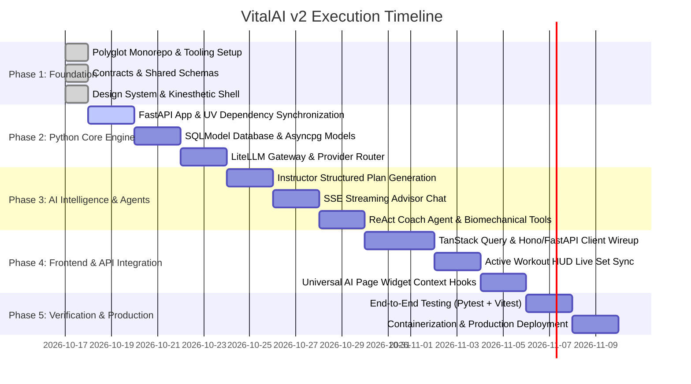

# VitalAI — Master Implementation Roadmap (Phased Execution)

> **Execution Strategy**: Progressive delivery across verified milestones with strict type-safety and testing at every stage.

---

## Milestone Overview

---

## Detailed Milestone Objectives

### Phase 1: Polyglot Foundation & Monorepo Redesign (Current Milestone - Ready to Merge)

- [x] Establish polyglot monorepo structure with Turborepo 2 + pnpm + UV.
- [x] Design `@vitalai/shared-types` with canonical Zod schemas matching backend specifications.
- [x] Design `@vitalai/ui` with Muscle Monster OKLCH theme tokens (Volt Green, Cyber Cyan, Ember Flame, Obsidian Carbon).
- [x] Scaffold `@vitalai/web` with kinetic motion, onboarding wizard, command center, active HUD, and universal insight widget.
- [x] Establish root automation (`Makefile`, `docker-compose.yml`, `.env.example`).
- [x] Update Staff-level documentation (`docs/ARCHITECTURE.md`, `docs/API_SPEC.md`, `docs/MASTER_ROADMAP.md`).

### Phase 2: Python AI Core Engine (`apps/api`)

- [ ] Initialize FastAPI ASGI app with CORS, lifespan handlers, and structured JSON logging.
- [ ] Implement SQLModel database models for `Profile`, `WorkoutPlan`, `Exercise`, `SessionLog`.
- [ ] Configure `LiteLLM` router supporting local Ollama (`llama3.2`, `deepseek-r1`) and cloud models (Gemini 2.0, Claude 3.5).
- [ ] Add unit tests verifying database migrations and mock provider calls.

### Phase 3: AI Intelligence, Structured Outputs & SSE Streaming

- [ ] Implement `Instructor` structured plan generator guaranteeing typed JSON Pydantic outputs.
- [ ] Implement Server-Sent Events (SSE) token streamer for real-time coach feedback.
- [ ] Build ReAct Agent loop equipped with biomechanical calculation tools (1RM, volume landmarks).

### Phase 4: Full-Stack Integration & Telemetry Wireup

- [ ] Connect `apps/web` TanStack Query hooks to live FastAPI endpoints.
- [ ] Wire active workout HUD set completions to live backend session logger.
- [ ] Wire dynamic profile editor to trigger real-time AI workout plan recalibration.

### Phase 5: Hardening & Production Release

- [ ] Comprehensive test suite: `uv run pytest` (backend) + `pnpm test` (frontend).
- [ ] Production Dockerfile with multi-stage build.
- [ ] Continuous Integration (GitHub Actions) running lint, typecheck, and test suites.
